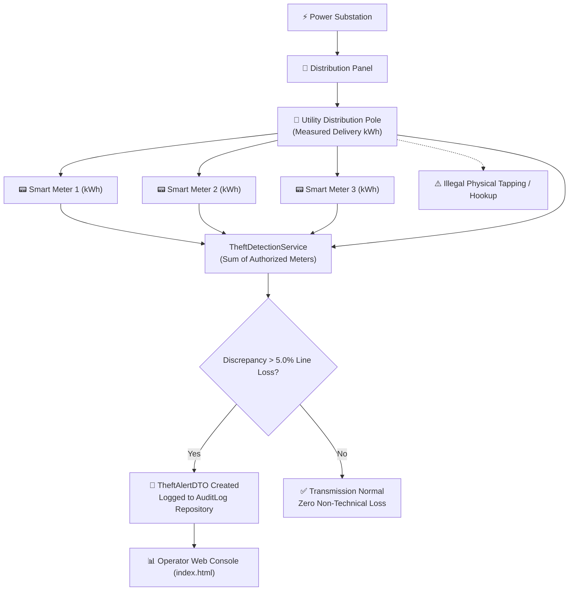

# ⚡ Smart Grid Electricity Theft Detection & Anomaly Monitoring

<p align="center">
  
  
  
  
  
</p>

An enterprise-grade utility intelligence microservice engineered with **Java 25** and **Spring Boot**. **Smart Grid Theft Detection** automates real-time energy audit reconciliation across electrical distribution networks, comparing substation and distribution pole power delivery against aggregate consumer smart meter telemetry to isolate power theft, illegal physical hookups, and transmission line anomalies.

---

## 🎯 Objective

Non-Technical Losses (NTL)—primarily direct line tapping, bypassed meters, and unauthorized utility loads—cost global energy providers tens of billions of dollars annually.

**Smart Grid Theft Detection** resolves this by:
- **Hierarchical Grid Modeling**: Representing the electrical topology across Substations, Distribution Panels, Utility Poles, and Consumer Meters.
- **Differential Energy Balancing**: Continuously balancing power delivered at the pole against aggregated downstream meter telemetry.
- **Tolerance-Aware Theft Classification**: Distinguishing acceptable physical technical impedance loss ($\le 5.0\%$) from illicit energy tapping.
- **Automated Incident Logging**: Persisting actionable audit trails (`AuditLog`) for utility inspection teams.

---

## 🏗️ Energy Reconciliation Workflow



---

## ✨ Key Features

- **🌐 Hierarchical Domain Entity Model**:
  - **`Substation`**: Primary medium-voltage grid distribution node.
  - **`DistributionPanel`**: Feeder line partition.
  - **`Pole`**: Terminal low-voltage utility distribution pole equipped with upstream monitoring sensors.
  - **`Meter`**: Tamper-resistant consumer smart meters reporting periodic consumption metrics.
  - **`AuditLog`**: Immutable event history tracking detected power discrepancies, stolen units, and timestamps.
- **⚙️ Algorithmic Theft Detection Engine (`TheftDetectionService`)**:
  - Implements differential equations reconciling input current against the sum of consumer loads:
    $$\Delta E = E_{\text{pole}} - \sum E_{\text{meters}}$$
  - Enforces `ALLOWED_LINE_LOSS = 5.0%` threshold; any divergence exceeding $5.0\%$ is flagged as illegal consumption.
- **📡 RESTful Microservice Architecture**:
  - `SmartGridController` exposes secure JSON endpoints for real-time SCADA and IoT gateway ingestion.
- **📊 Embedded Operator Dashboard**:
  - Direct web dashboard served via Spring Boot static assets (`/index.html`) visualizing active poles, alert statuses, and loss severity.

---

## 🛠️ Tech Stack Used

| Layer | Component | Version / Description |
|---|---|---|
| **Core Runtime** | Java OpenJDK | Version 25 (Modern virtual threads & pattern matching) |
| **Framework** | Spring Boot | Version 4.x / Microservice REST API |
| **Data Persistence** | Spring Data JPA / Hibernate | Object-Relational Mapping (ORM) and automated DDL schema |
| **Build Tool** | Apache Maven | Project lifecycle management via Maven Wrapper (`mvnw`) |
| **UI Presentation** | HTML5, CSS3, JavaScript | Lightweight operator monitoring dashboard |

---

## 📁 Repository Structure

```plaintext
Smart-Grid-Theft-Detection/
├── smart_grid/
│   └── smartgrid/
│       ├── pom.xml                  # Maven dependencies & build definitions
│       ├── mvnw / mvnw.cmd          # Maven cross-platform wrappers
│       ├── src/
│       │   ├── main/
│       │   │   ├── java/com/capstone/smartgrid/
│       │   │   │   ├── SmartgridApplication.java  # Spring Boot application entrypoint
│       │   │   │   ├── controller/                # REST API controllers
│       │   │   │   │   └── SmartGridController.java
│       │   │   │   ├── service/                   # Theft detection algorithm service
│       │   │   │   │   └── TheftDetectionService.java
│       │   │   │   ├── entity/                    # JPA database entities
│       │   │   │   │   ├── Substation.java
│       │   │   │   │   ├── DistributionPanel.java
│       │   │   │   │   ├── Pole.java
│       │   │   │   │   ├── Meter.java
│       │   │   │   │   └── AuditLog.java
│       │   │   │   ├── repository/                # Spring Data JPA repositories
│       │   │   │   └── dto/                       # Data Transfer Objects (TheftAlertDTO)
│       │   │   └── resources/
│       │   │       ├── application.properties     # Database & port configurations
│       │   │       └── static/index.html          # Embedded grid operations console
│       │   └── test/                              # Automated unit & integration tests
└── README.md                                      # Comprehensive project documentation
```

---

## ⚙️ Installation & Build Steps

### 1. Prerequisites
- **Java Development Kit (JDK 25+)** installed and configured on your `PATH`.
- Check via terminal:
  ```bash
  java -version
  ```

### 2. Clone the Repository
```bash
git clone https://github.com/kunalnevage10-lgtm/Smart-Grid-Theft-Detection.git
cd Smart-Grid-Theft-Detection/smart_grid/smartgrid
```

### 3. Build the Application
Use the bundled Maven wrapper to compile, run tests, and package the JAR:
* **Windows:**
  ```powershell
  .\mvnw.cmd clean package
  ```
* **macOS / Linux:**
  ```bash
  chmod +x ./mvnw
  ./mvnw clean package
  ```

---

## 🚀 Running the Application

### 1. Launch via Maven
```bash
# Windows
.\mvnw.cmd spring-boot:run

# macOS / Linux
./mvnw spring-boot:run
```

### 2. Access the Grid Dashboard
Once the Spring Boot application starts up on port `8080`, open your web browser:
```text
http://localhost:8080/
```

### 3. API Endpoints
- **Get Real-Time Theft Alerts**:
  ```http
  GET /api/theft/alerts
  ```
- **Query Grid Telemetry Status**:
  ```http
  GET /api/theft/poles
  ```

---

## 🛡️ License

This project is licensed under the [MIT License](LICENSE).
